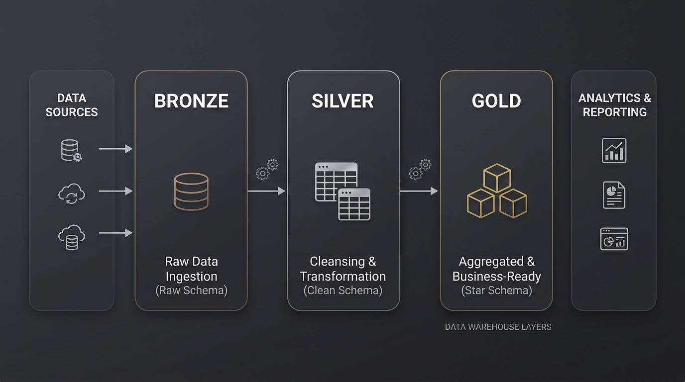
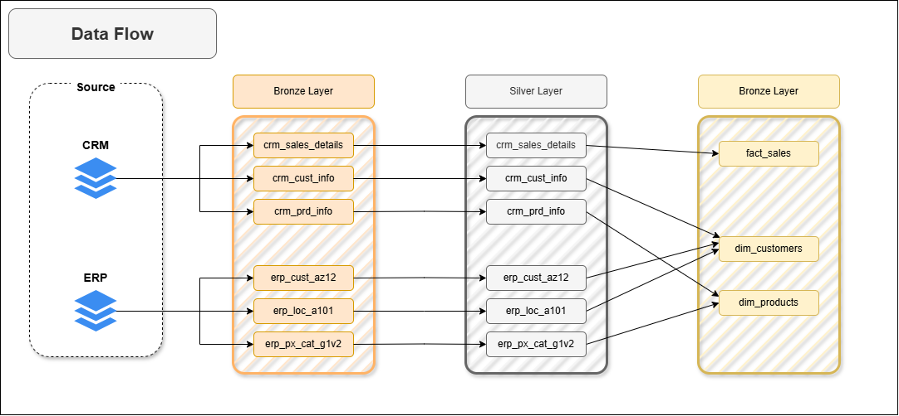

# Medallion Data Warehouse & Analytics

A SQL Server data warehouse project that integrates CRM and ERP data, implements the Medallion Architecture, and transforms raw sales data into analytics-ready datasets for business intelligence and reporting.

<div align="center">

<a href="https://amirhsoukhteh.github.io">
  
</a>



</div>

## Table of Contents

- [Overview](#overview)
- [Data Architecture](#data-architecture)
- [Project Objectives](#project-objectives)
- [Technology Stack](#technology-stack)
- [Data Sources](#data-sources)
- [Data Warehouse Layers](#data-warehouse-layers)
- [Getting Started](#getting-started)
- [Repository Structure](#repository-structure)
- [Documentation](#documentation)
- [License](#license)

## Overview

This project demonstrates the design and implementation of a modern SQL Server data warehouse using the Medallion Architecture. It integrates data from two source systems—CRM and ERP—through structured ETL pipelines, data quality checks, and dimensional modeling.

The resulting warehouse provides a unified, analytics-ready data model for exploring customer behavior, evaluating product performance, and analyzing sales trends.

The project covers the data engineering workflow from raw data ingestion to business-oriented SQL analytics, following practical data warehousing principles.

## Data Architecture

The warehouse follows the **Medallion Architecture**, organizing data into three layers: Bronze, Silver, and Gold.



### Bronze — Raw Data

Stores source data in its original form. CSV files from the CRM and ERP systems are ingested into SQL Server with minimal transformation.

### Silver — Cleaned & Standardized Data

Cleans, standardizes, and integrates the source data. This layer addresses data quality issues and prepares consistent datasets for downstream transformations.

### Gold — Business-Ready Data

Contains curated data modeled into fact and dimension tables using a star schema. This layer is designed for analytical queries, reporting, and business intelligence.

## Project Objectives

### Data Engineering

- Design a modern data warehouse using SQL Server.
- Integrate CRM and ERP data from CSV source files.
- Develop ETL processes to ingest, clean, standardize, and transform data.
- Implement data quality checks to improve data reliability.
- Build a star schema optimized for analytical queries.
- Document the warehouse structure, data model, and business-ready fields.

### Data Analytics

Use SQL to investigate key business areas:

- **Customer Behavior:** Analyze customer characteristics and purchasing patterns.
- **Product Performance:** Evaluate product performance and related sales metrics.
- **Sales Trends:** Explore sales patterns and changes over time.

The goal is to transform integrated source data into meaningful business insights that support informed decision-making.

I did **data exploration and analytics** part of this dataset in other repository click this [repository](https://github.com/AmirHSoukhteh/sql-data-analytics) to see more.

## Technology Stack

- **Database:** Microsoft SQL Server
- **SQL Development Environment:** SQL Server Management Studio (SSMS)
- **Data Sources:** CRM and ERP CSV files
- **Data Engineering:** SQL, ETL pipelines, data cleansing, and transformation
- **Data Modeling:** Medallion Architecture, star schema, fact and dimension tables
- **Quality Assurance:** SQL-based data quality checks

## Data Sources

The project uses two source systems containing complementary business information.

| Source | Data |
|---|---|
| CRM | Customer records, product information, and sales details |
| ERP | Customer birthdates and gender, location information, and product categories |

The datasets are provided as CSV files in the `datasets/` directory. The warehouse integrates these sources into a consistent structure suitable for analysis.

## Data Warehouse Layers

### 1. Bronze Layer

- Loads raw CSV data into SQL Server.
- Preserves source data for subsequent processing.
- Uses dedicated SQL scripts for table creation and data loading.

### 2. Silver Layer

- Cleans and standardizes source data.
- Resolves data quality issues.
- Integrates related CRM and ERP entities.
- Prepares consistent datasets for analytical modeling.

### 3. Gold Layer

- Organizes data into fact and dimension tables.
- Implements a star schema for analytical workloads.
- Provides business-ready datasets for reporting and SQL analysis.

Refer to [`docs/data_model.png`](./docs/data_model.png) for the data model and [`docs/data_catalog.md`](./docs/data_catalog.md) for Gold-layer field definitions and metadata.

## Getting Started

### Prerequisites

Before running the project, make sure you have:

- Microsoft SQL Server installed and running.
- SQL Server Management Studio (SSMS), or another compatible SQL client.
- Git to clone the repository.

SSMS is a database management tool; it does not replace the SQL Server database engine. The project scripts are written for SQL Server and may require modification to work with other database systems.

### 1. Clone the Repository

Choose either HTTPS or SSH:

```bash
# HTTPS
git clone https://github.com/AmirHSoukhteh/sql-data-warehouse.git

# SSH
git clone git@github.com:AmirHSoukhteh/sql-data-warehouse.git
```

Navigate to the project directory:

```bash
cd sql-data-warehouse
```

### 2. Create the Database and Schemas

Open the project in SSMS, connect to your SQL Server instance, and execute:

```text
scripts/init_database.sql
```

This script initializes the database and creates the schemas used by the warehouse.

### 3. Create and Load the Bronze Layer

First, execute:

```text
scripts/bronze/ddl_bronze.sql
```

Then open:

*Make sure change path_to_repository to your repository location.*
```text
scripts/bronze/procedure_load_bronze.sql
```

Execute procedure:
```sql
USE DataWarehouse;

EXEC bronze.load_bronze;
```

### 4. Build the Silver Layer

Execute the SQL scripts under:

```text
scripts/silver/
```

Follow the similar execution order to create the Silver-layer tables and run the cleansing, standardization, and integration transformations.

### 5. Build the Gold Layer

Execute the SQL script:

```text
scripts/gold/ddl_gold
```

This script create views for the analytical data structures, including fact and dimension tables, according to the project's star schema.

### 6. Validate the Data

Run the relevant checks available under:

```text
tests/
```

Use these checks to validate data quality and the integrity of the Silver and Gold layers.

> **Note:** Execute the scripts in the appropriate dependency order. Review individual scripts for database names, file paths, execution requirements, and any environment-specific settings before running them.

## Repository Structure

```text
sql-data-warehouse/
│
├── datasets/
│   ├── source_crm/              # CRM source CSV files
│   └── source_erp/              # ERP source CSV files
│
├── docs/
│   ├── data_flow.png            # Data flow architecture
│   ├── data_model.png           # Star schema and data model
│   ├── ETL.png                  # ETL techniques and workflow
│   ├── data_catalog.md          # Gold-layer data catalog
│   └── requirements.md          # Project and analytics requirements
│
├── scripts/
│   ├── init_database.sql        # Database and schema initialization
│   ├── bronze/                  # Raw data ingestion
│   ├── silver/                  # Cleansing and transformation
│   └── gold/                    # Analytical data modeling
│
├── tests/                       # Data quality checks
├── .pics/                       # README visual assets
├── .gitignore
├── LICENSE
└── README.md
```

## Documentation

| Resource | Description |
|---|---|
| [Data Flow](./docs/data_flow.png) | Data movement across the warehouse layers |
| [Data Model](./docs/data_model.png) | Fact and dimension table relationships |
| [ETL Workflow](./docs/ETL.png) | ETL techniques and methods |
| [Data Catalog](./docs/data_catalog.md) | Gold-layer field definitions and metadata |


## License

This project is licensed under the [MIT License](./LICENSE). You are free to use, modify, and distribute the project in accordance with the license terms.

---

## Acknowledgements

Special thanks to **[DataWithBaraa](https://github.com/DataWithBaraa/)** for their guidance.
